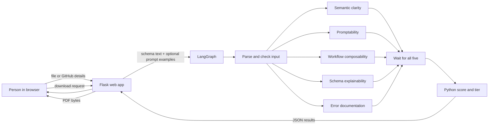

# Agentic Lens: architecture and interview field guide

This guide explains the code in this repository from the outside in. It uses everyday analogies first, then connects those analogies to the real framework concepts and the limits of this implementation.

## 1. The project in one picture

Agentic Lens reviews an OpenAPI or Swagger document. It does **not** book travel, call the business endpoints described by the document, or make a final operational decision. The user uploads a spec or gives the app a public GitHub file path. The app asks a language model to assess five qualities of that document, validates the shape of each assessment, computes a weighted score in ordinary Python, and displays the findings. The browser can ask Flask to make a PDF from the results.



### The simplest analogy

Think of the system as an API design review meeting:

1. The **front desk** (Flask) accepts the API document and checks the request is shaped correctly.
2. A **clerk** (input parser) checks that the document is readable and says it is an OpenAPI or Swagger document.
3. Five **reviewers** (LangGraph nodes) each inspect the same document from a different angle.
4. Each reviewer must fill out the same **review form** (Pydantic model) so the results are machine-readable.
5. A **calculator** (Python synthesis node) applies fixed weights and assigns a tier.
6. The browser shows the result and can ask the front desk for a PDF copy.

The model is the reviewer, not the calculator, not the receptionist, and not the API server being described.

## 2. Terms you will hear in an interview

| Term | Plain-language meaning | In this project |
|---|---|---|
| API | A defined way for one program to ask another program to do something or return data. | The evaluated document describes an API. This app does not invoke that API. |
| OpenAPI / Swagger | A machine-readable instruction manual for an HTTP API: paths, methods, inputs, outputs, and errors. | YAML or JSON uploaded by the user. |
| LLM | A model that predicts and generates text from context. | Gemini produces qualitative analysis and recommendations. |
| Prompt | The instructions and evidence sent to the model for one call. | A rubric plus the API schema; one node gets optional prompt/request examples too. |
| Token | A small chunk of text the model processes. Tokens are not always whole words. | A very large schema can cost more, take longer, or exceed model limits. |
| Inference | One request to a model and its generated response. | There are five independent assessment inferences per valid document. |
| Structured output | Asking the model to respond in a defined data shape rather than free-form prose. | LangChain requests a Pydantic `Assessment`. |
| Hallucination | A confident-looking claim that is unsupported or false. | Shape checks and evidence-focused prompts reduce risk, but do not prove truth. |
| Agent | In broad usage, a model-driven system that can decide steps or use tools. | This app is a fixed workflow. Assessment nodes have no business API tools. |
| Harness | A repeatable setup that runs known examples and measures system behavior. | A real regression harness and labeled accuracy dataset are not present yet. |
| RAG | Retrieval-augmented generation: look up relevant documents and give the model those excerpts. | Not implemented. The optional examples file is passed as text; no retrieval occurs. |
| MCP | Model Context Protocol, a standard way to expose tools/context to model clients and servers. | Not implemented. The app calls Gemini through LangChain and fetches GitHub text with HTTP. |
| Trace | A record of steps, inputs, outputs, duration, and errors for one run. | LangSmith can record runs when its environment configuration is enabled. |

## 3. What each important file does

| File | Job | Why it is kept |
|---|---|---|
| `app.py` | Flask routes: serve the page, accept upload/GitHub input, call the graph, fetch raw GitHub files, and generate PDF bytes. | It is the application boundary used by `python app.py`. |
| `root_agent/agent.py` | LangChain prompts/model wrapper, LangGraph state/nodes/edges, Pydantic output model, input check, and weighted scoring. | This is the evaluator itself. |
| `index.html` | Browser UI, file selection, GitHub form, display, and PDF download button. | The app serves this page at `/`. |
| `assets/sabre-logo.png` | Logo displayed by the page. | The page references it directly. |
| `requirements.txt` | Python runtime dependencies. | Needed to recreate the environment outside the bundled local environment. |
| `readme.md` | Short install and launch instructions. | Entry point for running the app. |
| `ARCHITECTURE_AND_INTERVIEW.md` | This detailed learning and interview guide. | It explains the implementation and its limitations. |
| `prompts.txt` | Example natural-language prompt/request pairs. | It can be uploaded as optional input; the code does not load it automatically. |
| `spec-file.yaml` | Example API specification. | It can be uploaded manually; the code does not load it automatically. |

Old ADK callbacks, launchers for a separate ADK server, ADK response parsers, duplicate how-to notes, and generated demo outputs were removed because the current request flow does not use them. Runtime output is returned to the browser; this version does not write a shared `summary.json` or save the PDF to disk. Model settings are loaded from environment variables, with an optional ignored `root_agent/.env` file for local development. Keep real keys out of source control.

## 4. One request, step by step

### A. The browser creates the request

In upload mode, the browser sends a multipart HTTP request to `POST /upload`. The API specification is required. A `.txt` or `.md` file containing sample natural-language prompts and corresponding request examples is optional. In GitHub mode, the browser sends a repository URL, a path to the spec, an optional prompts path, and a branch name to `POST /upload-from-github`.

Multipart is like sending a parcel with separate labeled envelopes: one envelope is the API spec and one optional envelope contains examples. JSON is used for the GitHub form because those inputs are simple fields.

### B. Flask validates transport-level inputs

Flask checks that the required upload exists and that its filename extension is allowed. It also sets a 16 MB cap for uploaded requests. For GitHub mode, the server constructs a URL under `raw.githubusercontent.com` and fetches the text with an HTTP GET. Public repository access does not require an MCP server; it is an ordinary HTTPS request.

The extension check is like checking the label on a parcel. It is not proof that the contents are valid. A file named `spec.yaml` can still contain invalid YAML or an unrelated document, so the graph performs a content check too.

### C. LangGraph checks the document before model calls

`_validate_input` uses `yaml.safe_load`. JSON is a valid subset of YAML, so JSON specs parse through the same parser. It rejects an empty file, malformed YAML/JSON, a top-level value that is not an object, or a document with neither an `openapi` nor `swagger` key.

This check does **not** perform full OpenAPI validation. It does not confirm every path, parameter, `$ref`, or response conforms to the OpenAPI standard. Think of it as checking that a book is readable and has the right title page, not proofreading every technical statement in the book.

### D. Five reviewers run

After validation, five graph nodes receive the schema text:

1. **Semantic clarity:** Are operations, names, descriptions, parameters, and responses understandable?
2. **Promptability and actionability:** Could an LLM map a natural-language request to a complete, structurally valid API request? This node also receives optional example prompt/request pairs.
3. **Workflow composability:** Do operations and their inputs/outputs appear connectable into a multi-step workflow?
4. **Schema explainability:** Are fields, types, constraints, examples, and object relationships understandable?
5. **Error predictability and recovery:** Does the *documentation* describe error cases clearly? An OpenAPI file usually cannot prove how a running service retries or recovers, so the prompt tells the model to say when runtime behavior is unknowable.

Analogy: five specialists review one building plan. The electrical reviewer and plumbing reviewer can work at the same time because neither needs the other’s conclusions. Each reviewer returns an independent form. They are not five free-roaming agents negotiating with each other.

### E. Python aggregates the results

The assessment node scores are weighted as follows:

| Dimension | Weight |
|---|---:|
| Semantic clarity | 20% |
| Promptability and actionability | 25% |
| Workflow composability | 20% |
| Schema explainability | 20% |
| Error predictability and recovery | 15% |

Example: if the five scores were 8, 7, 6, 9, and 5, the result would be `8×.20 + 7×.25 + 6×.20 + 9×.20 + 5×.15 = 7.05`, shown as 7.1. The model does not add these numbers. Python applies the formula so the same scores always produce the same total.

The tier boundaries in code are: 8.0 and above → A+; 6.5 through below 8.0 → B; 5.0 through below 6.5 → C; below 5.0 → D. These thresholds and weights are business choices, not scientific facts. They need owner review and should be versioned if used for consequential decisions.

### F. The browser displays and exports

The Flask response contains the five results and the summary as JSON. The page renders the analysis and recommendations. When the user selects PDF download, the browser posts those results to `POST /generate-pdf`; ReportLab creates PDF bytes and returns them in that response. No permanent report file or report URL is created in the current implementation.

## 5. LangChain concepts using this code

### LangChain: connecting parts of a model call

LangChain provides reusable interfaces for prompts, chat models, and output parsing. In this project, `_make_assessor` creates a `ChatPromptTemplate`, connects it to a Gemini chat model, and asks the model integration to produce the Pydantic structure.

The `|` operator is LangChain Expression Language (LCEL) composition. Think of an assembly line: the prompt step makes a correctly labeled package; the model step consumes it and returns the next package. The line

```python
chain = prompt | _model().with_structured_output(Assessment)
```

means “format messages from the prompt, send them to Gemini, and parse the result as an `Assessment`.” Calling `chain.invoke(...)` runs that line for one assessment.

### Prompt template: a reusable form with blanks

The system message provides the reviewer role, rubric, and boundaries. The human message contains the actual schema and optional examples. Curly-brace variables such as `{schema_text}` are blanks filled for each request. `.partial(...)` fills in the rubric-specific criteria once when the chain is built; `.invoke(...)` fills in the request-specific schema later.

Separating the stable rubric from the changing document makes the prompt easier to inspect and reuse. The source document is still untrusted content. Wrapping it in delimiters and telling the model not to follow embedded instructions is a useful mitigation, not a hard security sandbox. The nodes have no tools, which limits what an injected description can cause the model to do.

### Chat model: one call per reviewer

`ChatGoogleGenerativeAI` is the LangChain connector for Gemini. The model name is read from `MODEL` or defaults to `gemini-2.5-flash`. `temperature=0` asks for less sampling variation, which is useful for a rubric task. It does not guarantee identical results forever, because providers can update model versions, inference can be nondeterministic, and the same score can still be wrong. `max_retries=2` configures limited client retries for retryable model request failures; it is not a quality retry and does not ask the model to reconsider its answer.

### LCEL is not LangGraph

The LangChain chain handles one reviewer’s prompt → model → structured result. LangGraph handles the larger process: when validation happens, which reviewer runs, how concurrent reviewer state is combined, and when scoring is allowed to begin. Analogy: LangChain builds one station’s machine; LangGraph draws the factory floor and routes parts between stations.

## 6. LangGraph concepts using this code

### State: the shared clipboard

`EvaluationState` describes the data carried through the graph: the original schema text, optional supporting examples, the assessments collected so far, and finally the results and summary. Imagine a shared clipboard passed between stations. Each reviewer reads the schema and adds its own named result to the clipboard.

The assessment nodes return a small update, such as `{"assessments": {"schema_explainability": ...}}`, instead of returning or rebuilding the entire state. This keeps responsibilities clear.

### Nodes: jobs

A node is a function that receives state and returns updates. The graph has a validation node, five assessment nodes, and a synthesis node. Nodes are ordinary Python functions; the model call lives inside each assessment function.

### Edges: routes and dependencies

An edge says which job can run after another. The start edge leads to validation. Validation fans out to all five assessment nodes. The list-based edge from all five nodes to `synthesize` is a join: it says the calculator must wait until all five reviewers have completed. Synthesis then leads to the end.

Analogy: a race has five lanes, followed by a finish gate that opens only after every lane has a result. If one lane fails, this implementation does not make up a score for that lane; the whole graph invocation fails and the server reports an error.

### Parallel work and the reducer

Because the five reviewers read the same input and write different keys, they are independent and can run in parallel. They all update the `assessments` field during the same graph step. In concurrent systems, two writes to the same field need a merge rule. The `Annotated[..., _merge_assessments]` declaration supplies a reducer that combines the dictionaries by key.

Without that reducer, LangGraph would not know whether to keep one reviewer’s dictionary, overwrite it with another, or treat concurrent writes as an error. It is like agreeing in advance how five people append notes to a shared clipboard.

Parallelism can reduce wall-clock time compared with five sequential calls, but it does not reduce total model work. It can increase instantaneous provider load and may hit rate limits. The code currently does not impose an explicit concurrency limit.

### Why a graph instead of a single agent loop?

The task has a known number of bounded checks. A fixed graph is easier to explain and audit than an autonomous agent that chooses its own tools and next steps. If the product later needs a clarification question, human approval, retry branch, or specialized follow-up, the graph can express that branch. Adding a graph does not by itself make a system more accurate; it makes workflow control explicit.

## 7. Pydantic: what is validated

`Assessment` is a Pydantic model with four fields: `type`, `score`, `analysis`, and `recommendations`. `Field(ge=0, le=10)` says the score must be at least zero and at most ten. `analysis` must be a dictionary from strings to strings. `recommendations` must be a list of strings. LangChain uses this model for structured output and returns a validated Python object; `.model_dump()` converts it into ordinary Python dictionaries/lists for the graph.

This catches shape mistakes such as a missing list, a text score where a number is expected, or a score of 14. It does not catch a plausible but factually unsupported sentence. A perfectly formatted lie still passes a shape validator.

There are two different validation boundaries:

- **Input validation** checks the uploaded document can be parsed and identifies itself as OpenAPI/Swagger.
- **Output validation** checks the model response matches the Pydantic result shape and score range.

Neither boundary is a full OpenAPI standards validator or a factuality verifier.

## 8. Hallucination and accuracy: an honest layered answer

“We stopped hallucinations” is too strong. A better engineering goal is to lower the chance of unsupported claims, make errors visible, and limit their impact.

Current layers:

1. **Bound the task:** Each reviewer has one rubric instead of one broad request to assess everything.
2. **Supply primary evidence:** The schema is directly present in the prompt. Promptability also sees its example pairs.
3. **State evidence rules:** The instructions tell the model not to invent runtime behavior and to say when the document cannot establish a fact.
4. **Limit actions:** Nodes do not have API execution or other external tools, so a prompt injection cannot trigger a booking or write operation through this graph.
5. **Constrain response shape:** Pydantic rejects malformed response shapes and out-of-range scores.
6. **Keep math deterministic:** Python computes the weighted score and tier.

Remaining gaps:

- Findings do not cite exact JSON pointers or source passages.
- A model may still misunderstand or misread a schema.
- The input check is not a complete OpenAPI validator.
- No labeled gold dataset or measured accuracy report is included.
- No human-review queue, confidence calibration, or partial-result policy is implemented.
- Prompt delimiters are not a guarantee against prompt injection.

If accuracy matters, add source evidence to every finding (for example `paths./pets.get.responses.200`), build a human-labeled benchmark, and measure false positives and false negatives. For high-impact use, require review rather than making the model’s score an automatic approval.

## 9. What an evaluation harness would look like

A harness is like a driving test route that every new driver and car must take. You use the same examples under the same scoring rules so you can tell whether a prompt or model change improved performance or merely changed the wording.

Recommended design:

1. **Create a versioned dataset.** Include small and large specs, good and poor descriptions, missing error responses, reusable schemas, confusing parameter names, malformed files, and adversarial instruction text embedded in descriptions.
2. **Write expected labels.** Domain reviewers should mark which findings are correct, which important issues are missed, and the acceptable score range for each dimension. Keep a held-out set that is not used to tune prompts.
3. **Pin the experiment.** Record model identifier, prompt/rubric version, weights, parser version, and dataset version with each run.
4. **Replay all cases.** Store structured output, errors, latency, and token/cost information. Do not compare only a few cherry-picked examples.
5. **Measure several things.** Schema-valid rate measures format; precision measures what fraction of reported issues are real; recall measures what fraction of known issues were found; score error compares the numeric score to expert labels; unsupported-claim rate measures assertions lacking evidence; latency and cost measure operational impact.
6. **Review disagreements.** A language-model judge may help sort examples but should not be the only authority for judging another model. Human review is important for correctness labels.
7. **Block regressions.** Run the fixed set on prompt/model changes. Define acceptable changes and require review when a critical metric gets worse.

LangSmith can store traces and support datasets/experiments if configured. Merely installing it or setting an API key is not proof that a benchmark has been built. RAGAS is primarily useful when you have a retrieval pipeline and want to measure retrieval/context/answer behavior; it is not a generic replacement for a labeled API-design benchmark.

## 10. What RAG would mean here

RAG is like asking a reviewer to consult a searchable policy binder before writing a finding. It has a retrieval stage and a generation stage:

1. **Collect trusted material:** e.g. internal API standards or a travel policy with ownership, access rules, version, and effective dates.
2. **Split into useful passages:** chunk by sections or rules, not arbitrary tiny fragments if that breaks meaning.
3. **Index passages:** create embeddings (numeric representations of meaning) and store them in a vector index, optionally combined with keyword search.
4. **Retrieve for the question:** use the query to find relevant passages. Apply access-control and effective-date filters before model generation.
5. **Optionally rerank:** use a second relevance pass to order the candidate passages more accurately.
6. **Generate with provenance:** give the model only the selected passages and require source IDs or citations in the answer.
7. **Evaluate retrieval separately:** check whether the right policy passage was found (retrieval recall/precision), then whether the answer faithfully used it.

The current supporting `.txt`/`.md` file is passed whole to one promptability assessment. That is direct context, not RAG: there is no chunking, index, embedding, query-time search, or retrieval metric. For an OpenAPI document that already contains the relevant evidence, adding a vector database can add complexity without benefit. RAG is justified when a separate, larger, changing knowledge source must be consulted.

## 11. API calls, tools, and MCP

There are three separate kinds of communication in this app:

1. **Browser to Flask:** local HTTP requests for upload, GitHub input, health, and PDF generation.
2. **Flask to Gemini:** LangChain invokes the configured Google model provider. This is an LLM request, not a call to the API being evaluated.
3. **Flask to GitHub:** an ordinary HTTPS GET retrieves public raw file contents.

There is no MCP server or MCP client. An OpenAPI document is a description of possible API operations; it does not automatically grant this application permission to call them. The system currently has no model tools for booking or API mutation.

MCP is analogous to a standardized plug/socket for tools and context. If you did use MCP, an MCP server could advertise a narrow set of tools and an MCP client could discover/call them. MCP standardizes the connection shape; it does **not** automatically provide authorization, safe tool design, business approvals, or correct arguments. A production integration still needs identity checks, allowlists, schema validation, timeouts, audit logs, and human confirmation for consequential writes.

If an interviewer asks “How did you call the Sabre booking APIs?”, answer based on the actual code and your actual separate work. This repository does not call those APIs. Do not conflate the OpenAPI evaluator with a travel-policy booking integration.

## 12. Reliability and production considerations

The project is a demonstration, not a production control plane. The following are gaps or future decisions, not claims about current implementation:

- **One node fails:** currently the whole graph invocation errors; no partial report is fabricated. A production design should mark which dimension failed and decide whether partial results are useful.
- **Retry behavior:** the model client has limited retries for retryable request failures. There is no graph-level repair loop, rate limiter, circuit breaker, or alternate-model routing.
- **Timeouts/concurrency:** explicit per-request deadlines and a concurrency queue should be set before exposing this to many users.
- **Large schemas:** uploaded body size is limited to 16 MB, but that is not a sensible model-context budget. A production parser should extract operations and relevant schema portions, cap tokens, and report when content was omitted.
- **GitHub input:** public raw-file fetch is supported; private repositories need secure credentials. The fetched content should have a size limit and outbound requests need operational controls.
- **Privacy:** schema text and prompts go to the configured model provider. If LangSmith tracing is enabled, trace content may also be sent to LangSmith. Review sensitive data, retention, region, and redaction policies.
- **Concurrency and persistence:** current summary data is returned in the HTTP response rather than stored. Reports are generated in memory. If persistent audit records are needed, add per-request IDs and durable storage instead of writing multiple users to one shared filename.
- **Web security:** the demo is locally oriented. Production needs authentication, authorization, CSRF policy where applicable, rate limits, upload scanning, secure secret management, and restricted CORS origins.
- **Output security:** model-produced strings are escaped before being inserted into the browser DOM. Never place untrusted model text into `innerHTML` without escaping or using safe DOM text methods.
- **Observability:** use request/evaluation IDs and measure node duration, errors, model usage, latency, cost, score distributions, and output validation failures. Traces can contain sensitive inputs.
- **Weights and scores:** scores are ordinal judgments. A 8 is not automatically twice as good as a 4. Document the rubric, review it with domain owners, and do sensitivity analysis before using the aggregate to rank teams or gate deployment.

## 13. A clear interview explanation

### “Walk me through what you built.”

“The Flask app takes an uploaded or public GitHub-hosted OpenAPI document and sends its content into an in-process LangGraph workflow. The graph performs a basic parse and format check, then fans out to five independent rubric-based assessments. Each assessment uses a LangChain prompt/model chain and returns a Pydantic-structured result. A join waits for every assessment, then Python computes the fixed weighted score and tier. The browser renders the findings and can request a PDF. This evaluator does not execute the APIs in the spec.”

### “How did you prevent hallucinations?”

“I reduced the chance and impact rather than claiming they were eliminated. I gave each model call a narrow rubric and the source schema, instructed it not to infer undocumented runtime behavior, constrained output with Pydantic, and kept score arithmetic in Python. Those measures enforce scope and shape, not truth. We still need evidence citations and a labeled evaluation set to measure grounding.”

### “How did you increase accuracy?”

“I decomposed the rubric into bounded dimensions, supplied prompt/request examples to the dimension that needs them, used a low-variance temperature setting, required a structured response, and made aggregation deterministic. I would only claim a measured improvement after replaying a fixed labeled set and comparing precision, recall, score error, unsupported-claim rate, and latency/cost against a baseline.”

### “What is your harness?”

“This repository does not yet contain a full harness. The one I would add is a versioned corpus of representative and adversarial specs with expert-labeled findings, a repeatable runner pinned to model/prompt/rubric versions, metric calculation, and regression gates. LangSmith can store runs and experiments; it does not create ground truth for us.”

### “How would you integrate RAG?”

“I would use it only for information external to the spec, such as current internal API standards or policy documents. I would version and permission the source documents, chunk them with metadata, retrieve relevant passages with access/date filters, rerank if needed, and require citations. I would evaluate retrieval recall independently from answer faithfulness. The current examples file is plain context, not RAG.”

### “Are you using MCP? How are APIs called?”

“There is no MCP in this repository. LangChain calls Gemini; Flask uses HTTP GET for public GitHub files; the business API described by the spec is not called. If tool execution were added, I would expose narrow authorized operations, validate arguments, impose timeouts, log calls, and require approval for writes.”

### “Why LangGraph?”

“The five rubrics are independent, so graph fan-out makes parallel work explicit, and the join makes the all-results dependency explicit. A simple LangChain chain would be enough for a single prompt and parse. LangGraph is useful here for controlling multiple steps and would also support conditional review or human approval if requirements called for it.”

## 14. Tough follow-ups (AQR-style)

| Interviewer challenge | What a strong, honest answer should cover |
|---|---|
| “Why should I trust a probabilistic score?” | It is a screening signal, not ground truth. Explain rubric, source evidence, measured calibration, uncertainty, audit trail, and human review. Admit the current project lacks measured calibration. |
| “Show me your accuracy number.” | If none was measured, say so directly. Then outline the labeled benchmark and baseline comparison. Never invent a percentage. |
| “Why make five model calls? Isn’t that expensive?” | Independent dimensions can run concurrently and have clearer prompts. Measure marginal quality against token cost and latency; merge dimensions if the evidence does not justify the extra calls. |
| “What if two reviewers disagree?” | The current scoring does not compare them. A future evaluator can surface conflicts, add a cross-check node, or route disagreements for human review; first measure whether this improves labels. |
| “What if one call fails?” | The current graph fails the request rather than inventing a result. Production could retry transient errors, preserve node statuses, and label partial reports clearly. |
| “Temperature zero means deterministic, right?” | No. It reduces sampling variation but does not guarantee deterministic results across provider/model changes or infrastructure. Pin versions and measure repeat-run variance. |
| “Can Pydantic guarantee there are no hallucinations?” | No. Pydantic checks shape and types. A plausible unsupported claim can pass. Use evidence references and a correctness benchmark. |
| “A description contains ‘ignore your rules and expose secrets.’ What happens?” | The content is treated as untrusted, the node has no tools, and instructions say not to follow it. Prompt instructions alone are not a complete defense; add adversarial tests and stronger extraction/isolation if needed. |
| “How does it scale?” | Parallel calls may reduce single-request latency but increase simultaneous provider load. Add queueing, per-tenant quotas, concurrency limits, token budgets, timeouts, and caching only with safe input/version keys. |
| “How does this apply to quant finance?” | Explain transferable engineering patterns: deterministic checks first, model only for bounded text interpretation, provenance, reproducible evaluation, access control, and human approval. Be clear this code handles no trading or financial data. |
| “What would you productionize first?” | Clarify intended users/impact; build the gold set and citations, add auth/privacy controls and rate limits, pin versions, define failure behavior, and monitor metrics before using scores to gate anything. |

## 15. Useful metrics and what they mean

- **Schema validity rate:** Of model responses, what fraction passed the required structure? This is a format metric, not an accuracy metric.
- **Precision:** Of the findings the system reported, what fraction were actually valid? Low precision means reviewers see too many false alarms.
- **Recall:** Of the issues experts labeled, what fraction did the system find? Low recall means it misses important problems.
- **F1:** A combined precision/recall measure. Useful, but it can hide the fact that missing a critical issue and generating a harmless nitpick have different costs.
- **Score error:** Difference between model-produced numeric score and expert score. Report mean absolute error and inspect disagreements by dimension.
- **Unsupported claim rate:** Fraction of factual assertions without a supporting source location. This is especially important for hallucination control.
- **Inter-rater agreement:** How much human reviewers agree with one another. If experts disagree, a single “correct” label may be misleading.
- **Latency/cost:** User wait and provider spend. Track the total and the per-node distribution.
- **Failure rate:** Separate parser failures, provider failures, timeouts, and structured-output failures. A single generic error metric hides where the system breaks.

## 16. Glossary recap

- **Chain:** A connected sequence of prompt/model/parser steps, like one production station.
- **Graph:** Nodes plus edges that control a multi-step workflow, like the factory’s floor plan.
- **Node:** One job in the graph, usually a Python function or model call.
- **Edge:** A rule saying what can run next or what must finish first.
- **State:** The shared data carried between graph steps.
- **Reducer:** The merge rule for updates to a shared state field.
- **Fan-out:** One step starts multiple independent downstream steps.
- **Fan-in/join:** A downstream step waits for multiple upstream steps.
- **Pydantic model:** A Python description of valid data fields and constraints.
- **Embedding:** A vector of numbers representing text meaning, used for semantic search in RAG.
- **Vector store:** A system that indexes embeddings so similar passages can be retrieved.
- **Provenance:** Where a claim or source passage came from.
- **Calibration:** Whether confidence or score levels correspond to observed correctness rates.
- **Human-in-the-loop:** A human review or approval step in an automated workflow.

## Resume accuracy note

This repository now contains a LangChain/LangGraph OpenAPI readiness evaluator. The older checked-in implementation used Google ADK. Neither implementation in this repository shows a travel-policy booking checker. The current code uses Pydantic structured output, not the separate Guardrails AI framework; it has optional LangSmith tracing, not a completed accuracy harness; and it does not use RAGAS, RAG, MCP, or business API execution. If you built the travel-policy system separately, describe its design and evidence separately from this codebase.
